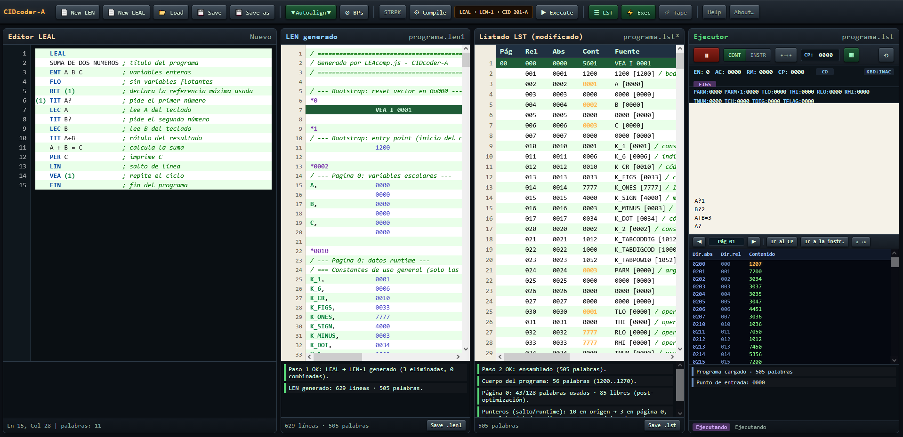

# CIDcoder-A

**Editor, compilador para el lenguaje LEAL y ensamblador LEN1 sobre la minicomputadora cubana CID 201-A — todo en una sola página HTML.**

Este proyecto recupera en software la cadena de herramientas de la minicomputadora CID 201-A (ICID, Cuba, 1971): se escribe un programa en el lenguaje algorítmico **LEAL**, se compila al ensamblador **LEN-1** y se ejecuta en un simulador completo de la máquina — con teletipo RFT T-51, perforador, mapa de memoria y microcódigo. Sin dependencias: se abre directo en el navegador, no hay build.


<p align="center"></p>

- **Estado:** hito vigente versión **0.1.51** (13/Nov/2026), «Baseline limpio; fases 0–2 en curso». Hito anterior 0.1.50.2, eliminación de `*`; antes 0.1.50.1, revisión interna y 0.1.50, Optimización.
- **Calidad:** 8 suites de regresión permanentes en verde — **1046 checks / 0 fallos** + `survey` **50/50 modos**.

## Primeros pasos

1. **Abre** `CIDcoder-A.html` en un navegador moderno. No necesita servidor (solo para las suites de `TEST/`).
2. **Escribe** el programa LEN1 o LEAL en el editor. El análisis estático avisa antes de generar LEN-1 (÷0 literal, desborde de plegado, variables no declaradas, mezclas char/entero…).
3. **Compila**. 
4. **Ejecuta** en el modelo del CID 201-A: la salida aparece en el teletipo simulado.
5. **Ayuda integrada:** la pestaña **Ayuda** de la aplicación es el manual de usuario, con secciones LEAL y ensamblador LEN-1, según se este trabajando en el editor.

---

## LEAL


### 1. Introducción e Historia

El **LEAL** (*LEnguaje ALgorítmico*) es un lenguaje de programación de alto nivel creado en Cuba entre 1970 y 1971 por el Centro de Investigación Digital (CID), bajo la dirección de Víctor Llopis Zayas-Bazán. Fue diseñado específicamente para las minicomputadoras de la serie CID, comenzando por la **CID 201-A**.

Su diseño tomó conceptos del *Autocode* de la computadora británica Elliot 803B Mark III. A diferencia de lenguajes como FORTRAN o BASIC que usan paréntesis y precedencia de operadores, LEAL utiliza una notación polaca y simbólica estricta, evaluando las expresiones **siempre de izquierda a derecha**.

Con el tiempo, el lenguaje evolucionó en tres versiones principales:
*   **LEAL-A:** Orientado al cálculo científico. Funcionaba con cintas de papel perforado y carecía de comentarios.
*   **LEAL-B:** Más evolucionado. Introdujo comentarios (usando `;`), mejoró el manejo de subrutinas, la gestión de periféricos (teletipos, discos) y la lectura/escritura de caracteres.
*   **LEAL-F:** Desarrollado para la CID 300/10. Combinaba cálculo científico con gestión económica.

En la actualidad, el emulador **CIDcoder-A** implementa un dialecto moderno compatible con el LEAL original, adaptado a las limitaciones de la arquitectura de 12 bits.

---

### 2. Estructura General de un Programa

Todo programa en LEAL se divide en dos partes principales: el **Encabezamiento** y el **Cuerpo**.

#### 2.1. El Encabezamiento
Contiene la configuración inicial del programa y la declaración de variables. Es de cumplimiento obligatorio.

```leal
LEAL                 ; Primera línea obligatoria
TITULO MI PROGRAMA   ; Título descriptivo (opcional)
ENT A B C D          ; Declaración de variables enteras (24 bits)
FLO X Y Z            ; Declaración de variables flotantes (24 bits)
REF (10)             ; Declaración del número de referencia máximo
```

#### 2.2. El Cuerpo
Contiene las instrucciones ejecutables. Puede incluir asignaciones, saltos, bucles, E/S y subrutinas. Debe finalizar con la instrucción `FIN`.

---

### 3. Variables, Tipos y Números de Referencia

#### 3.1. Variables
*   **Nomenclatura:** Se utiliza **exclusivamente una letra mayúscula de la A a la Z** (se excluye la Ñ). Nombres como `OP`, `T1` o `VAR` generarán un error de compilación.
*   **Tipos:** Una variable es Entera (`ENT`) o Flotante (`FLO`). El tipo es inmutable y se define en el encabezamiento. No se permite mezclar tipos en una misma operación.
*   **Sufijos (Arreglos):** Se permiten subíndices entre paréntesis. Ejemplo: `A(0)`, `A(I)`. El tamaño máximo se declara al definir la variable: `ENT V(10)` crea un arreglo de 0 a 10.

#### 3.2. Números de Referencia (Etiquetas)
Los números de referencia sirven como etiquetas para los saltos.
*   Se escriben al inicio de la línea, entre paréntesis y seguidos de la instrucción: `(1) A + B = C`.
*   Deben ser constantes enteras positivas (no se permite el `0`).
*   **Regla del compilador:** Deben numerarse de forma consecutiva `(1)`, `(2)`, `(3)`... y la declaración `REF(n)` debe indicar exactamente el número más alto utilizado en el cuerpo. Si usas hasta la etiqueta `(15)`, debes poner `REF(15)`.

---

### 4. Asignación, Aritmética y Evaluación

La regla de oro de LEAL es: **La asignación se escribe con el destino a la derecha** (`expresión = destino`), y **las operaciones se evalúan estrictamente de izquierda a derecha, sin precedencia**.

#### 4.1. Operadores
*   `+` : Suma
*   `-` : Resta
*   `:` : Multiplicación
*   `/` : División (trunca hacia cero)

#### 4.2. Ejemplos de Asignación
```leal
A + B = C         ; Equivale a C = A + B
5 = A             ; Equivale a A = 5
A + B : C = D     ; Equivale a D = (A + B) * C (¡NO A + (B*C)!)
-A = A            ; Cambia el signo de A
```

#### 4.3. Asignación Encadenada
Permite realizar varias asignaciones en una línea. El tramo intermedio debe empezar por la variable que recibirá el resultado anterior.
```leal
A + B = C : 2 = D  ; C = A+B, luego D = C * 2
```

#### 4.4. Funciones Matemáticas
Las funciones se aplican sobre el resultado de la expresión anterior.
*   `SEN`, `COS`, `ACT`, `LOG`, `LNE`, `EXP`, `RAC` (Raíz cuadrada). 
    *   *Nota de compatibilidad:* En CIDcoder-A, estas funciones trascendentes aún no están implementadas en hardware. Deben emularse con series de Taylor o aproximaciones (como Newton-Raphson para `RAC`).
*   `PEN` (Parte entera), `FRA` (Parte fraccionaria).
*   `NOR` (Normalizar de entero a flotante), `EAB` (Valor absoluto entero), `FAB` (Valor absoluto flotante).
*   `NEG` (Negación).

---

### 5. Control de Flujo (Saltos y Condicionales)

LEAL no tiene bloques `IF/ELSE`. Utiliza saltos condicionales basados en el valor de una expresión.

#### 5.1. Salto Incondicional
*   `VEA (n)`: Salta a la etiqueta `(n)`.

#### 5.2. Saltos Condicionales
Se evalúa una expresión y se salta según el resultado:
*   `SSP (n)`: Salta si el resultado es **Positivo** (> 0).
*   `SSN (n)`: Salta si el resultado es **Negativo** (< 0).
*   `SSC (n)`: Salta si el resultado es **Cero** (= 0).
*   `SNP (n)`: Salta si el resultado es **No Positivo** (≤ 0).
*   `SNN (n)`: Salta si el resultado es **No Negativo** (≥ 0).
*   `SNC (n)`: Salta si el resultado es **No Cero** (≠ 0).

*Ejemplo:*
```leal
I - 10 ? SSP (20)  ; Si I > 10, salta a (20)
I - 5 ? SSC (30)   ; Si I == 5, salta a (30)
```

#### 5.3. Bucles (CIC / REP)
El bucle se inicia con una etiqueta y la instrucción `CIC`, y se cierra con `REP`.
*   `REP (n)`: Bucle infinito (se sale usando `VEA`).
*   `REP (n) I'v1'v2'v3`: Recorre la lista de valores (CIC tipo 1). 
    *   *Advertencia:* Ejecuta N+1 iteraciones (la primera usa el valor previo de I).
*   `REP (n) I, paso, límite`: Bucle numérico clásico (CIC tipo 2). `I = I + paso` mientras `I <= límite`.
*   `REP (n) I, paso' K`: Bucle de conteo exacto (CIC tipo 3). Repite K veces incrementando I en paso.

---

### 6. Subrutinas (VAS, CRU, FRU)

El uso de subrutinas permite modularidad. Se definen en el cuerpo del programa. 

*   **Llamada:** `VAS (n) arg1, arg2, arg3`
*   **Declaración de entrada:** `(n) CRU in1, in2`
*   **Declaración de salida:** `(n) FRU (n) out1`

*Regla de oro:* La cantidad de argumentos en `VAS` debe coincidir exactamente con la suma de receptores en `CRU` y emisores en `FRU`.

---

### 7. Entrada y Salida (E/S)

*   **LEC X:** Lee un número entero desde el teletipo y lo guarda en `X`.
*   **PER X:** Imprime el valor de `X`.
*   **TIT HOLA:** Imprime texto literal.
*   **LIN:** Salto de línea (CR+LF).
*   **ESP n:** Imprime `n` espacios.
*   **DIG m,n:** Define el formato de impresión flotante (m dígitos enteros, n decimales).
*   **LCA A:** Lee una cadena de caracteres en el arreglo `A`.
*   **PCA A:** Imprime la cadena almacenada en `A`.
*   **ALT:** Detiene la ejecución.
*   **FIN:** Fin de la compilación.

---

### Ejemplo mínimo

```text
LEAL
TITULO SUMA DEMO        ; declaración inerte: no emite ninguna palabra
ENT A B C               ; variables enteras de 24 bits
5 = A
3 = B
A + B = C
PER C
FIN
```

**Salida en el teletipo:** `8`.

---

### 8. Guía de Programación para el Hardware y el Compilador

Para que un programa compile correctamente y no agote los recursos de la CID 201-A (4096 palabras de memoria de 12 bits), el programador debe tener en cuenta las siguientes reglas estrictas:

#### 8.1. Gestión de la Memoria (Página 0 y Arreglos)
*   **Página 0:** Las primeras 128 palabras de memoria son el recurso más escaso. Aquí se guardan las variables escalares, los punteros de salto y el paso de parámetros. **No declares decenas de variables sueltas.** Si necesitas más de 15 variables, usa un arreglo.
*   **Arreglos:** Los arreglos se ubican automáticamente al final de la memoria, donde hay amplio espacio. Declarar un arreglo `FLO A(50)` es mucho más eficiente en espacio que declarar 50 variables flotantes.
*   **Flotantes:** Cada variable flotante (`FLO`) ocupa 2 palabras de memoria. Los enteros (`ENT`) ocupan 1 palabra.
*   **Subrutinas:** Pasar muchos argumentos a una subrutina (`VAS`) llena rápidamente la página 0. Si una subrutina necesita muchos datos, es mejor que lea y escriba directamente en variables globales.

#### 8.2. Asignación y Aritmética
*   **Subíndices:** LEAL **no permite** expresiones dentro de los paréntesis. `A(I+1)` es un error de compilación. Debes calcular el índice antes: `I + 1 = K` y luego usar `A(K)`.
*   **Precedencia:** Al no haber precedencia, fórmulas complejas como `(A+B)*C` deben descomponerse en pasos o usar la asignación encadenada: `A + B = C : D = X`.
*   **Precisión Flotante:** La precisión es de 24 bits (aproximadamente 5 dígitos decimales). Es propensa a la acumulación de errores en bucles largos. No es apta para contabilidad exacta.
*   **Desbordamiento:** Si una suma o multiplicación entera excede los 24 bits (rango de -8,388,608 a +8,388,607), el programa se detendrá con un error `E:DESB`.

#### 8.3. Control de Flujo y Etiquetas
*   **Condicionales:** No existen `AND` ni `OR`. Un `IF X<0 OR X>7` se traduce en dos líneas consecutivas:
    ```leal
    X - 1 ? SSN (error)
    X - 8 ? SSP (error)
    ```
*   **Finalización de subrutinas:** La instrucción `FIN` le dice al compilador que deje de leer código. Si tienes subrutinas, el flujo principal debe terminar con `ALT` antes de definirlas, y el `FIN` debe estar en la última línea del archivo.
*   **REF(n):** Si usas una etiqueta `(20)`, el `REF` debe ser `(20)` o mayor. Si el `REF` es menor, la compilación fallará.

#### 8.4. Limitaciones con Cadenas (Strings)
*   Debido a un bug de diseño del compilador moderno, intentar leer un carácter individual de un arreglo de caracteres (`A(I)`) devuelve 2 palabras de memoria a la vez. 
*   **Regla:** Usa `LCA` y `PCA` solo para leer e imprimir la cadena completa (cajas opacas). No intentes procesar la cadena carácter por carácter (como en un cifrado César).

## Simulación más completa.

Los archivos `.lst` guardados pueden cargarse en el emulador completo de la CID 201-A, disponible en el repositorio de GitHub: [CIDmulator-A](https://github.com/maikelsz/CIDmulatorCID201A), y en GitHubPages: [CIDmulator-A](https://maikelsz.github.io/CIDcoder-A/CIDcoder-A.html)
Para ello:
1-"Encender" la computadora.
2-Cargar el archivo `.lst`.
3-Poner los 12 interruptores con la dirección de inicio. Los programas compilados desde LEAL el vector de incio esta en la dicección 0000, los que fueorn escritos en LEN1 pueden empezar en cualquier lugar que el autor decidiera, revisar el archivo .lst o el LEN1 fuente.
4-Apretar CPR. La direccion seleccionada pasara al registro Contador de Programa.
5-Apretar COM para comenzar.
Si la computadora esta en ejecución, primero detenerla con ALT, luego seguir los pasos anteriores desde el 2.

## Qué soporta hoy

| Área | Estado |
|---|---|
| Enteros 24 bits | Completo: `+ − : /` con `E:DESB`/`E:DIV0` y parada (sin envoltura), condiciones, saltos combinados, ciclos |
| Flotantes | Declaraciones, aritmética `+ - : /`, `NEG`/`FAB`/`PEN`/`FRA`/`NOR`/`INV` (1/x), `RAC` (raíz cuadrada, ≤1 ULP), `EXP` (exponencial), `LNE` (logaritmo natural), `LOG` (logaritmo base 10), `SEN` (seno), `COS` (coseno), `FRA` en expresiones complejas, `LEC` y `PER` flotante , **mixtas ENT↔FLO con destino FLO**  |
| E/S | `LEC` int/float/dual, `PER` int/float con formato `DIG m,n` (default 4,2; m ≤ 8, n ≤ 5 saturados con aviso; «DIG n» exponencial → error), `LIN`, `ESP`, `TIT` (inerte), teletipo 100 ch/s en UI/pruebas (histórico 10 ch/s) |
| Cadenas | Buffers `LCA`/`PCA` y `MDI`/`MID` (desplazamientos), en UNPK y PKD |
| Subrutinas | `VAS`/`CRU`/`FRU` con asertos permanentes (Ola AUDIT) |

**Pendiente conocido:** salida exponencial «`DIG n`»  y formato decimal del manual (5 dec, redondeo del 6º ≥ 5).

## Créditos

LEAL fue desarrollado en Cuba por el Ing. Víctor M. Llopis Zayas-Bazán (Centro de Investigación Digital, 1970-1971) con la colaboración de V. A. Orsini, Emilio Lino, Fedor Sierra, María E. Bragado y Miguel Fonfría. La CID 201-A es diseño de la ICID (1971). Proyecto y simulador: MSZ — más en [Tecno-Historia Cubana](https://tecnohistoriacubana.wordpress.com).
